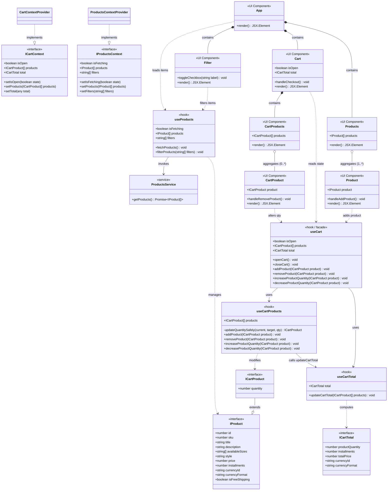
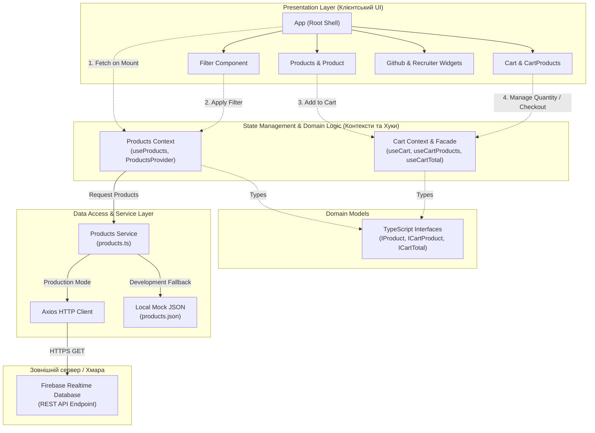

# Лабораторна робота №1
## Аналіз структури програмної системи та зворотне проєктування (Reverse Engineering)

**Дисципліна**: Реінжиніринг програмного забезпечення  
**Тема**: Початковий аналіз програмного проєкту, виявлення його структури, виділення компонентів та побудова UML-діаграм для зворотного проєктування  
**Література**: Bass L., Clements P., Kazman R. *Software Architecture in Practice (SEI Series in Software Engineering)*. Print2print, 2022. 442 с. ISBN 978‐0‐13‐688609‐9.

---

## 1. Вибір проєкту з відкритим кодом та клонування

Для виконання лабораторної роботи було обрано відкритий веб-проєкт **`react-shopping-cart`**, розроблений Jefferson Ribeiro.

* **Офіційний репозиторій**: [https://github.com/jeffersonRibeiro/react-shopping-cart](https://github.com/jeffersonRibeiro/react-shopping-cart)
* **Команда клонування**:
  ```bash
  git clone https://github.com/jeffersonRibeiro/react-shopping-cart.git lab1/react-shopping-cart
  ```
* **Обґрунтування вибору**:
  * Проєкт є повноцінним веб-додатком електронної комерції (інтернет-магазин) на базі сучасної бібліотеки React та мови TypeScript.
  * Має виражену тришарову клієнтську архітектуру (Presentation, State Management, Data Services).
  * **Обсяг коду**: уся кодова база каталогу `src/` налічує **2 065 рядків коду** (у 76 файлах включно з тестами та стилями), що повністю відповідає умові «не більше 5000 рядків».

| Показник | Значення |
| :--- | :--- |
| **Мова програмування** | TypeScript / JavaScript (ES6+) |
| **Основний фреймворк** | React 18 |
| **Загальна кількість файлів у `src`** | 76 |
| **Сумарний обсяг коду (SLOC)** | 2 065 рядків |
| **Ліцензія** | MIT License |

---

## 2. Призначення програми, стек технологій та функціональність

### Призначення
`react-shopping-cart` — це клієнтський односторінковий веб-додаток (Single Page Application, SPA), що моделює інтерфейс інтернет-магазину брендового одягу. Додаток забезпечує швидку та інтерактивну взаємодію покупця з каталогом товарів без перезавантаження сторінки.

### Стек технологій
* **Фронтенд**: React 18, TypeScript 4.x.
* **Керування станом (State Management)**: React Context API + Custom Hooks (`useCart`, `useProducts`, `useCartTotal`, `useCartProducts`).
* **Стилізація**: `styled-components` (CSS-in-JS).
* **Мережева взаємодія**: Axios (HTTP клієнт) + Firebase Realtime Database REST API (у production-режимі) та локальний JSON-файл (у development-режимі).
* **Тестування**: Jest, React Testing Library.

### Основні функціональні можливості
1. **Каталог товарів (Product Catalog)**: динамічне завантаження товарів з бекенду або локального джерела, відображення карток товарів із ціною, розмірами, фотографіями та бейджами безкоштовної доставки.
2. **Фільтрація за розмірами (Size Filter)**: миттєва мульти-фільтрація списку товарів за розмірною сіткою (`XS`, `S`, `M`, `ML`, `L`, `XL`, `XXL`).
3. **Плаваючий кошик (Floating Cart Drawer)**:
   * відкриття/закриття бічної панелі кошика;
   * додавання товару в один клік;
   * зміна кількості одиниць кожного товару (+/-);
   * видалення окремих товарів із кошика;
   * миттєвий перерахунок загальної вартості замовлення (Subtotal) та розрахунок щомісячних платежів при розстрочці (Installments).
4. **Оформлення замовлення (Checkout)**: валідація наявності товарів у кошику та виведення фінальної суми покупки.

---

## 3. Структура каталогів проєкту

Структура вихідного коду організована відповідно до модульного підходу, розділяючи компоненти відображення, глобальний стан, сервіси та моделі:

```text
react-shopping-cart/
├── .circleci/                 # Конфігурація середовища безперервної інтеграції (CI)
├── .firebase/                 # Конфігураційні файли хостингу Google Firebase
├── public/                    # Статичні загальнодоступні файли HTML, favicon, маніфест
│   ├── favicon.ico
│   ├── index.html             # Кореневий HTML-шаблон SPA
│   └── manifest.json
├── src/                       # Основний вихідний код додатку
│   ├── commons/               # Загальні стилі та глобальні константи
│   │   └── style/             # Глобальні стилі (GlobalStyle) через styled-components
│   ├── components/            # Модулі інтерфейсу користувача (UI Presentation Components)
│   │   ├── App/               # Головний контейнер-оболонка додатку
│   │   ├── Cart/              # Модуль кошика покупця (віджет, кнопка, список)
│   │   │   └── CartProducts/  # Компонент рендерингу списку позицій кошика
│   │   │       └── CartProduct/ # Окрема позиція товару в кошику (+ / - / delete)
│   │   ├── Filter/            # Модуль фільтрації товарів за доступними розмірами
│   │   ├── Github/            # Інформаційні кнопки та посилання на репозиторій GitHub
│   │   ├── Loader/            # Індикатор завантаження (спінер)
│   │   ├── Products/          # Контейнер сітки товарів (Grid)
│   │   │   └── Product/       # Картка окремого товару (фото, ціна, кнопка «Add to cart»)
│   │   └── Recruiter/         # Додатковий промо-віджет автора
│   ├── contexts/              # Стан додатку (React Context API та кастомні хуки)
│   │   ├── cart-context/      # Контекст кошика (провайдер, хуки useCart, useCartTotal, useCartProducts)
│   │   └── products-context/  # Контекст каталогу (провайдер, хук useProducts)
│   ├── models/                # Доменні типи та інтерфейси TypeScript (Domain Entities)
│   │   └── index.ts           # Інтерфейси IProduct, ICartProduct, ICartTotal тощо
│   ├── services/              # Рівень отримання даних (Data Access Layer)
│   │   └── products.ts        # HTTP-запити до REST API через Axios / fallback JSON
│   ├── static/                # Статичні зображення товарів та локальні JSON-дані
│   │   ├── json/              # products.json — мокові дані для розробки
│   │   └── products/          # Зображення одягу у форматі webp
│   ├── utils/                 # Допоміжні утиліти (форматування валют, ціни тощо)
│   ├── index.tsx              # Вхідна точка виконання клієнтського додатку
│   └── setupTests.ts          # Конфігурація тестового оточення Jest
├── package.json               # Маніфест залежностей npm та скрипти збірки
├── tsconfig.json              # Конфігурація компілятора TypeScript
└── README.md                  # Опис проєкту від автора
```

### Призначення основних каталогів
* **`src/components/`**: містить візуальні компоненти React, розбиті за функціональними блоками. Кожна папка містить компонент `.tsx`, ізольовані стилі `style.ts` та юніт-тести `__tests__/`.
* **`src/contexts/`**: реалізує шар управління станом на основі React Context API. Відокремлює бізнес-стан кошика та каталогу від UI-компонентів.
* **`src/models/`**: централізоване сховище контрактів даних (TypeScript interfaces), які описують сутності предметної області.
* **`src/services/`**: ізольований шар роботи з мережею, що абстрагує клієнтську частину від деталей бекенду.
* **`src/utils/`**: чисті функції загального призначення, зокрема форматування грошових сум за локаллю.

---

## 4. Список основних класів, інтерфейсів та модулів

### 1. Доменні моделі (Domain Layer)
* **`IProduct`** (Інтерфейс доменної сутності): описує базову одиницю товару в каталозі (ідентифікатор, артикул `sku`, назва, доступні розміри, опис, вартість, кількість частин розстрочки, прапорець безкоштовної доставки). Забезпечує сувору типізацію сутностей у всьому додатку.
* **`ICartProduct`** (Інтерфейс елемента кошика): розширює базовий інтерфейс `IProduct` полем `quantity` (кількість обраних одиниць). Використовується для відстеження поточного замовлення клієнта в кошику.
* **`ICartTotal`** (Інтерфейс підсумкового стану кошика): інкапсулює агреговані розрахункові дані щодо вмісту кошика (загальна кількість одиниць, максимальна кількість місяців розстрочки, сумарна ціна замовлення та валюта).
* **`IGetProductsResponse`** (Інтерфейс мережевої відповіді): визначає структуру JSON-пакета, що надходить від сервера або локального джерела при запиті списку товарів.

### 2. Керування станом та хуки (State Management)
* **`CartContextProvider` (`CartProvider`)**: React-провайдер глобального стану кошика, який зберігає список товарів у кошику, підсумкову суму та прапорець видимості модального вікна. Забезпечує доступ до стану кошика для всіх дочірніх компонентів дерева React.
* **`useCart`** (Фасадний кастомний хук): виступає єдиною точкою входу для UI-компонентів, які взаємодіють із кошиком. Об'єднує функції відкриття/закриття кошика, додавання/видалення товарів та отримання поточної суми.
* **`useCartProducts`** (Хук маніпуляції товарами в кошику): містить бізнес-алгоритми додавання товару, видалення позиції, а також безпечного збільшення чи зменшення кількості (`updateQuantitySafely`). Безпосередньо викликає перерахунок загальної вартості при будь-якій зміні.
* **`useCartTotal`** (Хук розрахунку підсумків): реалізує математичну агрегацію вартості товарів, сумарної кількості одиниць та параметрів розстрочки за допомогою функції `reduce`. Оновлює глобальний об'єкт `total` у контексті кошика.
* **`ProductsContextProvider` (`ProductsProvider`)**: провайдер стану товарного каталогу, що зберігає завантажений перелік товарів, прапорець активного завантаження (`isFetching`) та активні фільтри розмірів.
* **`useProducts`** (Хук каталогу та фільтрації): надає методи `fetchProducts()` для завантаження каталогу та `filterProducts()` для фільтрації товарів за обраними розмірами. Відповідає за синхронізацію серверних даних із локальним станом клієнта.

### 3. Рівень відображення (UI Components)
* **`App`** (Головний контейнер додатку): кореневий компонент структури, який ініціалізує первинне завантаження каталогу товарів при монтуванні. Розміщує двоколонкову розмітку інтерфейсу (фільтри ліворуч, товари праворуч, кошик поверх).
* **`Products`** (Компонент сітки товарів): контейнер відображення каталогу, що ітерує масив об'єктів `IProduct` та рендерить відповідний список компонентів `Product`. Відображає кількість знайдених товарів.
* **`Product`** (Картка одиниці товару): візуальний компонент товару, що відображає фотографію, назву, цінник, умови розстрочки та кнопку додавання. Обробляє події натискання мишею та комбінації клавіш клавіатури для людей з обмеженими можливостями.
* **`Filter`** (Компонент панелі фільтрів): відображає перелік доступних розмірів у вигляді кнопок-перемикачів. Керує множиною вибраних фільтрів та ініціює перезавантаження товарів відповідно до критеріїв.
* **`Cart`** (Компонент бічного віджета кошика): відповідає за рендеринг плаваючої панелі кошика, кнопки відкриття з лічильником позицій, футера з фінальною вартістю та кнопки оформлення замовлення.
* **`CartProducts`** (Контейнер списку обраних товарів): перевіряє наявність елементів у кошику та виводить повідомлення про порожній кошик або генерує список компонентів `CartProduct`.
* **`CartProduct`** (Рядок товару в кошику): надає користувачеві елементи керування окремим товаром: кнопки збільшення/зменшення кількості, видалення позиції та відображення поточної вартості.

### 4. Сервіси та утиліти (Services & Utils)
* **`services/products.ts`** (Сервіс отримання товарів): модуль виклику зовнішнього REST API за допомогою бібліотеки `axios`. У тестовому середовищі автоматично підставляє локальний статичний файл `products.json`.
* **`formatPrice`** (Утиліта форматування грошових значень): чиста функція форматування числових цін у зручний для користувача рядок відповідно до переданого коду валюти.

---

## 5. UML-діаграма класів та інтерфейсів



*PlantUML файл:* `lab1/diagrams/class_diagram.puml`

---

## 6. UML-діаграма компонентів



*PlantUML файл:* `lab1/diagrams/component_diagram.puml`

---

## 7. Аналіз проблемних місць програмної системи

### 1. Надмірні залежності (Tight Coupling) та проблема похідного стану (Derived State)
* **Проблема**: сутність `total` (загальна ціна, кількість товарів, розстрочка) виділена в окремий незалежний стан `useState` у `CartContextProvider`. Через це хук `useCartProducts` змушений при кожній операції мутації списку товарів вручну викликати `updateCartTotal(updatedProducts)`.
* **Наслідки**: сильна зв'язаність (Tight Coupling). Якщо в майбутньому інший розробник викличе оновлення `products` без виклику `updateCartTotal`, дані в кошику та на екрані розійдуться.
* **Шлях вирішення**: `total` має бути **похідним станом** (Derived State), який обчислюється автоматично через `useMemo` на основі масиву `products`.

### 2. Нераціональна повторна фільтрація через повний мережевий запит
* **Проблема**: у файлі `src/contexts/products-context/useProducts.tsx` метод `filterProducts` при кожній зміні прапорця розміру знову звертається до бекенду через `getProducts().then(...)`, після чого застосовує фільтр до отриманої відповіді.
* **Наслідки**: зайві HTTP-запити при кожному кліку по фільтрах.
* **Шлях вирішення**: зберігати повний первинний перелік товарів `allProducts` окремо від відфільтрованого списку `filteredProducts`, виконуючи фільтрацію локально в пам'яті.

### 3. «Божественні» класи/хуки та порушення Single Responsibility Principle
* **Проблема**: компонент `Cart.tsx` поєднує рендеринг модального вікна, розрахунок щомісячного платежу розстрочки (`total.totalPrice / total.installments`), логіку кнопки `Checkout` та виклик системного `alert()`.
* **Шлях вирішення**: винести логіку розрахунку розстрочки в окрему утиліту, замінити системні `alert()` на окремий модуль сповіщень.

### 4. Дублювання функціоналу та витік бізнес-правил в UI (Leaky Abstraction)
* **Проблема**: кнопка зменшення кількості товару блокується в UI `CartProduct.tsx` за допомогою `disabled={quantity === 1 ? true : false}`. Однак функція зменшення кількості `decreaseProductQuantity` у хуку `useCartProducts.ts` не перевіряє значення `quantity` на мінімальний поріг.
* **Наслідки**: бізнес-правило («кількість товару не може бути меншою за 1») контролюється лише HTML-кнопкою, а не доменом.
* **Шлях вирішення**: додати перевірку в `useCartProducts` (якщо кількість стає $\le 0$, автоматично видаляти товар або ігнорувати дію).

### 5. Відсутність обробки помилок (Missing Error Handling)
* **Проблема**: у сервісі `services/products.ts` та хуку `useProducts.tsx` відсутні блоки `try/catch` або `.catch()`.
* **Наслідки**: у разі помилки мережі стан `isFetching` назавжди залишається рівним `true`, інтерфейс зависає на спінері `Loader`.

### 6. Відсутність персистентності стану (No State Persistence)
* **Проблема**: кошик зберігається виключно в пам'яті браузера (`useState`). При оновленні сторінки всі додані товари втрачаються. Доцільно додати синхронізацію з `localStorage`.

---

## 8. Висновки про архітектуру системи

### Сильні сторони:
* Чітка модульна декомпозиція та ізоляція стилів (`styled-components`).
* Повна типізація даних через TypeScript інтерфейси.
* Висока тестова придатність завдяки винесенню бізнес-логіки в ізольовані хуки.

### Слабкі сторони:
* Зайвий сетевий overhead при повторній фільтрації товарів.
* Ручне оновлення похідного стану `total` замість реактивного обчислення.
* Відсутність обробки помилок мережі та відсутність збереження стану в `localStorage`.
* Витік бізнес-правил із шару логіки в UI-шар.
